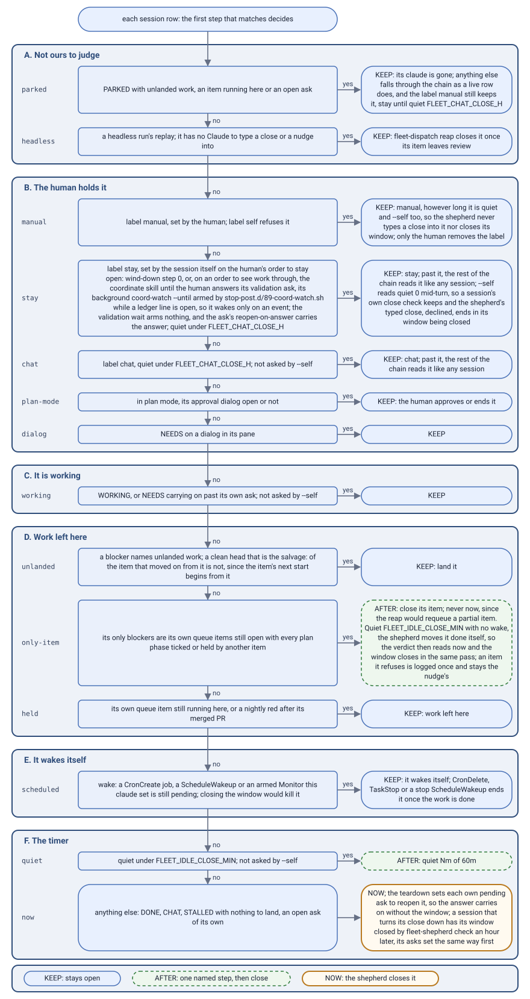

# Fleet state: the document and its vocabulary

Every view of the agent fleet (phone and Home Assistant, the shepherd, fleet-bench) reads one file instead of working session state out for itself:

```
~/.local/state/fleet/state.json        ($FLEET_STATE_FILE)
```

`fleet-sessions --write` is the only writer; `fleet-sessions tick` is `--write` after a fetch of each repo, and also appends the stage changes since its last pass to `~/.agent/shepherd/watch.log`. They run on these triggers:

| Trigger | When | Why |
| --- | --- | --- |
| `fleet-state.timer` | `tick` every minute | git, gh and plan files have no change event; the hub Sessions tab and watch.log need a fresh pass |
| `fleet-state.path` | `tick` when `agent-ask` posts, answers or cancels an ask (it rewrites `~/.agent/asks/.changed`) | A new ask shows as NEEDS within seconds |
| `fleet-bench sample`, `fleet-shepherd` | `--write`, every 10 minutes and on each shepherd pass | Each needs a pass of its own to act on |

The document is built beside the target and renamed into place, so a reader never sees half of one. A pass that started before the document on disk was generated leaves it alone, so a slow pass cannot overwrite a newer one. After each pass `fleet-state.service` starts `agent-mqtt-sessions.service`, which republishes to Home Assistant.

## Two fields, never one word

A session has two independent states, and no surface may fold them into one word:

- **`activity`** is what the Claude process is doing right now, read from agent-panel. It changes many times a minute.
- **`bucket`** is where the session is in its delivery: does it need the human, has it landed, is it stuck. It is derived from git, gh, the plan file and the ask queue, and changes a few times an hour.

An `idle` session can be NEEDS (an ask is open), LANDED (a plan phase nobody holds) or STALLED (a green PR nobody merged). Reading "idle" as "done" was the mistake this split exists to stop: `claude-status.sh` used to count idle panes as `done`.

The document holds `activity` as of `generated_at`, a pass old. Who is waiting on the human now is read live everywhere: the `agent-core` crate (a status file under `~/.claude/sessions`) is its one source, `agent_core::agent::Agent::needs_attention` its one definition, and `boards::state_with` lays it over the document for every reader of the boards, so an answered dialog is not NEEDS and a new one is, before the next pass. Worker-host rows have no local status file and stay a pass behind. Other slow facts (PR, CI, stage) come from the document. No view computes a bucket itself.

### activity

| Value | Meaning |
| --- | --- |
| `busy` | Mid-turn |
| `waiting` | Blocked on a prompt or a permission in the pane |
| `shell` | Turn ended, a background shell is still running |
| `idle` | Turn ended, nothing running |
| `parked` | No Claude process: `claude-acct park` exited it, and its ledger is in `~/.agent/parked/<tmux session>` |

### bucket

Decided by `session_bucket` in `.local/bin/fleet-sessions`, in this order (first match wins). The `reason` field carries the detail. A parked session decides first: its claude is gone, so a message would wake nothing. A pending ask and a ready open PR that conflicts with the default branch decide before `activity`: a session busy on other work still waits on its ask, and a PR that is otherwise ready waits on nothing but the conflict. Ready is green checks, or no checks and the session idle 20m or more. A branch PR's checks are its `statusCheckRollup` plus the newest dispatched run of each gate workflow (`FLEET_GATE_WORKFLOWS`, default Tests) on a commit its head holds (`gate_ci`): a pool gate is a `workflow_dispatch` run, which never shows in the rollup, so Checks alone passing read green while the gate was queued or red (ar-191). A conflict on a PR whose checks are red or running is named in the reason of its other bucket (`PR #9 CI red, conflicts with the default branch`) and is not a conflict nudge: resolving it before the PR is ready invites the next conflict and a fresh gate. A session's PR is its branch's PR in the cwd's repo or, when there is none, the last open PR it opened in another repo (`sibling_pr`, from the transcript), named the way GitHub cross-references it (`PR o/other#42 CI red`); its CI is one `gh pr view` reused for `FLEET_MAIN_TTL`, and its conflict is unknown, since the cwd's clone cannot measure it. A merged or closed branch PR counts only when this session made it (`pr_made_here`): its plan's `## Phases` names `#N`, it opened or merged it, or, when no plan of another window in the same worktree names `#N`, its transcript holds the PR's URL or it pushed the branch. A PR belongs to the plan it served (ar-492): worktrees and their branches are shared and recycled, and a session that ran `gh pr view` on another window's PR holds its URL, so a PR found by branch name alone may be another session's; that one is dropped, with the commits it holds, and the row falls back to its own plan. An open branch PR always counts: it is unlanded work in the tree whoever opened it.

This table is the one definition of every bucket: no other file restates one, and `tests/unit/fleet_states_doc.bats` fails when the words `fleet-sessions` emits differ from it, a row lacks an actor, action or pinning test, a pinning test does not exist, or a bucket whose actor is the shepherd is missing from `fleet-shepherd`'s due lines.

| Bucket | Entry facts (first match wins, in this order) | Exit | Actor | Action | Pinned by |
| --- | --- | --- | --- | --- | --- |
| PARKED | `claude-acct park` exited its claude to save usage, and `~/.agent/parked/<key>` holds the resume. agent-panel cannot list it, so the pass reads the ledger; a ledger beside a live claude is stale and the live row wins | `claude-acct unpark` | fleet-pace, from the shepherd's `pace:` line | Never nudged or escalated (its claude is gone). While the machine reads CLEAR with no hold, a `pace: parked <targets>` due line says to unpark them. One the budget checkpoint parked is left out: that park paged the human, who resumes it | `a parked session is PARKED whatever its facts, so it is never nudged`; `a parked session on a CLEAR machine with no hold is a pace line; a park its ledger gives an owner and a held machine are not` |
| NEEDS | A prompt, permission or dialog waiting, a pending ask (even while busy; an attended session files every question it leaves the human, `stop-post.d/88-ask-filed.sh`), or plan approval | The human answers | The human; the shepherd escalates once | Answer it. The shepherd pages it once. A row whose session carries on past its question (busy, or a gate shell WORKING would allow) reads `N pending ask(s), carrying on`, stays NEEDS, and also keeps WORKING's overdue check | `a pending ask or plan mode is NEEDS`; `a pending ask is NEEDS whatever the status; one still working past it reads carrying on`; `a NEEDS session carrying on past its ask keeps the overdue check; a plain or busy one does not` |
| STALLED | A ready open PR that conflicts with the default branch (even while busy), an idle session (`FLEET_API_ERROR_IDLE_MIN`) whose last transcript message is Claude Code's own `API Error` line, unless it is finished (the fact `turn ended on API Error <code>` carries the error's minute, so a second error is a new fact), or idle 20m with unlanded work: dirty files, files off the default branch (in a submodule: off both its default branch and the commit the superproject's default branch pins) and no PR (an open PR whose head holds HEAD, the oldest of a stack, is its PR: a stacked branch's commits went out in the PR built on it), a red or green-but-unmerged PR (not one riding an open landing train, which is WORKING), commits after a merged PR, a merge suspected of turning a nightly red, its PR closed unmerged with no merged PR of its own, or a queue item of its own still running here (any running item whose `session:` or `sessions:` names it, so a merged side PR for another item never reads DONE) with nothing else unlanded, or a plan file the pane recorded that does not exist (`its plan file is missing`: its phases are unknown, so it never reads finished unless its queue item moved on); when every plan phase is ticked or held by another item the reason reads `its item <slug> is still open with every phase done or queued` (the close step "STALLED, only its own queue items") | The fact changes | The session, nudged once by the shepherd; then the human | Nudge with the fact's next step (shepherd skill, step 3); escalate once if the same fact survives the nudge. A session past its budget checkpoint is parked | `a green PR that conflicts with the default branch is STALLED whatever the status`; `an open PR is STALLED when red or green-unmerged, WORKING while CI runs`; `no PR: dirty or ahead is STALLED, clean is CHAT, a closed PR is STALLED unless one of its own merged`; `end to end: a stacked branch inside another open PR is that PR's, not files with no PR (ar-82)`; `a merged PR suspected of turning a nightly red is STALLED, not LANDED`; `a turn that ended on an API Error at an idle prompt is STALLED, not WORKING (ar-2143)`; `a session's queue item decides a clean branch with no plan: moved on is DONE, still running here is STALLED`; `a merged side PR is not DONE while an item still runs here: every running item names the session`; `a recorded plan file that is missing is its own verdict: STALLED, never DONE, unless its item moved on (ar-2368)`; `submodule_pin: a submodule is unlanded only when off both its default branch and the superproject's pin (ar-2606)` |
| WORKING | Busy, a background shell younger than 2h that waits on a gate, a test or a subagent (a gate counts in any directory when the session's claude runs it, and a live `gate-and-land.sh`, `ci-gate.sh`, `gate-line.py --recheck` or `agent-land` process (`FLEET_QUEUE_GATES`, a gate queued for its landing turn) counts past 2h too, since it ends itself; any other shell counts only until idle 20m, and a shell in `tail --pid=<its own parent>` never counts: it waits on itself, so its reason says so, appended to what its other facts read, and it is a blocker on the row), a background subagent younger than 2h even when this tree's own work is finished (it leaves the session `idle`), a heavy child process in its own pane (`fleet-assess` PANE column; another window of the same tmux session does not count), a PR whose red jobs all ran no steps (`PR #N CI never started`, ci `NOSTART`: an Actions billing or spending-limit block, so no code is red and no fix exists; each job's step count is read once from the Actions API; a mixed red, a check that is not a job or an unreadable job stays STALLED red), a PR whose CI is running (a pool gate dispatched on its head counts, and so does a red that is only the gate line, jobs whose only failed steps match `FLEET_GATE_LINE_STEPS`, while a gate on the head itself runs or the session's own background shell is a gate, such as a `ci-gate.sh` queued for the landing slot), an open PR riding an open landing train (`PR #N waiting on train #T`, whatever its own CI: an OPEN PR on a `FLEET_TRAIN_BRANCH` branch, default `train/`, whose title names `#N` and whose head holds the PR's head; a head pushed since the train was built reads its own CI again), an open PR queued for its landing turn (`PR #N waiting on the landing queue`, unless its own Checks are red past the slot's refusal, a red job failing outside `FLEET_GATE_LINE_STEPS` or a gate already red on its head: the PR carries `FLEET_QUEUE_LABEL`, default `landing-queue`, which unity-core-playground's gate-line.py sets, read from the PR store's labels), an idle session with an open plan phase and a live recurring cron it scheduled (`live_cron`: not cancelled, made or fired (a "Running scheduled task" row) since this claude started if session-only, under 7 days old; any such job counts, since closing the session ends it; `a live cron runs its next phase`), or idle under 20m (unless its last message is an `API Error` line, which is STALLED) | Idle past the thresholds | The session; the shepherd reads it only on an `overdue:` line | None. A phase open twice its estimate and at least an hour gets one `overdue:` nudge, then one escalation | `idle under FLEET_IDLE_MIN is WORKING, at it the facts decide`; `a background shell waits FLEET_SHELL_STALE_MIN only on a gate, a test or a subagent`; `a shell waiting on itself is not WORKING, and is a blocker on the row (ar-1118)`; `a background subagent is WORKING over this tree's finished facts until FLEET_SHELL_STALE_MIN (ar-69)`; `end to end: a heavy child counts only for its own pane, not every window of its tmux session (ar-290)`; `a WORKING phase open twice its estimate and the floor is overdue, with the exact ledger call`; `end to end: a red gate line is CI running while a gate on its head runs, red once it finished (ar-82)`; `end to end: a red gate line is CI running while the session's own gate shell waits for the landing slot (ar-2366)`; `end to end: a PR riding an open landing train is WORKING waiting on the train, not CI red (ar-2160)`; `end to end: a PR in the landing queue is WORKING waiting on the landing queue, not CI red or green-not-merged (ar-1285)`; `a live landing-queue gate is WORKING past FLEET_SHELL_STALE_MIN, a gate that is not queued is idle (ar-2346)`; `queue_match takes a gate-and-land.sh, ci-gate.sh, agent-land or gate-line.py --recheck argument, and not a reader of its log (ar-2346)`, `a silent agent-land waiting on its checks or the landing slot is a queue gate, whatever its output age (ar-2244)`, `a next phase a live cron runs reads WORKING, not LANDED; the same row with no cron stays LANDED (ar-2449)`, `live_cron: a recurring job is live until cancelled, after the claude start, and under 7 days old (ar-2449)`, `live_cron: a session-only job that fires after the claude start is live; one that fired only before is not (ar-2604)`; `an open PR whose red jobs ran no steps is WORKING, waiting on billing; a job with a step is a real red (ar-2606)` |
| LANDED | Nothing unlanded, and the plan has an unchecked phase no queue item holds (an item that records `phases:` holds only those numbers; one with none whose task says `Phase <N> of <plan>` or `Phase <name> of <plan>` holds that phase; one that names no phase holds all), or a plan with no `## Phases` checklist and nothing merged. With a phase open, the row names a merged PR (`its PRs #N merged`) only when the plan's `## Phases` section names it: a side item's PR is not a phase landing. Not LANDED: an idle session with a live recurring cron it scheduled (CronCreate, not cancelled, made or fired since this claude started, under 7 days old; `live_cron` reads its transcript) runs the phase in place and reads WORKING, `a live cron runs its next phase` | Its phases are queued (DONE) or started (WORKING) | The quiet timer, then fleet-dispatch reap | Nothing: no nudge. It closes on the quiet timer like any finished session, and once its window is gone fleet-dispatch reap (`reconcile_plans`) files the open phases of an approved plan, the one filer of a plan. A phase left on the plan's `- [-]` gate is not open, so a session whose open phases are all gated reaches DONE. A close that survives is escalated once; past `FLEET_SHEPHERD_REMIND_H` (4h) unchanged, the human is paged again, once per fact per day | `the plan decides once nothing is unlanded: all phases ticked is DONE, one left is LANDED`; `end to end: a merged PR another session made on a shared worktree branch is not this session's (ar-455)`; `check re-pages an escalated row left unchanged for hours, once per fact per day, naming the decision (ar-455)`; `a next phase a live cron runs reads WORKING, not LANDED; the same row with no cron stays LANDED (ar-2449)`; `end to end: a merged PR no phase of the plan names is not claimed by the row (ar-2606)`; `due gives a LANDED row no nudge: it closes on the quiet timer and fleet-dispatch files its phases; a STALLED one is nudged` |
| DONE | Nothing unlanded or open, no queue item of its own still running here, idle, and: every `## Phases` line ticked or a queue item; or its PRs merged with no checklist or no plan file (one phase of work); or, with no plan file, its queue item moved on (done, requeued, or running in another session, read from the item's `sessions:`, or `session:` when one claude lives in that tmux session); or its queue item is of a kind whose `kinds.json` `exit` is doc+ask and handed off, its `report` doc on disk and its `ask` filed, which is then the deliverable and not an open ask of the session's; or its worktree was removed | The session is gone | The shepherd, then the session | The 15-minute check types `/wind-down auto` once its close verdict is now (a worker row, or one with something still waiting on the human, waits); escalate once if it survives | `the plan decides once nothing is unlanded: all phases ticked is DONE, one left is LANDED`; `a plan whose unchecked phases are queue items is DONE once this phase lands, and finished`; `end to end: a clean session reads its queue item from any state, and a removed worktree is DONE`; `end to end: a doc+ask kind whose doc exists and ask is filed is DONE; its ask is handed over, not open` |
| CHAT | Idle 20m or more, no ask or prompt, clean, no open PR, no plan file, no merged PR of its own and no queue item naming it; or a cwd outside any git repo. In practice the human's own conversation | The human replies (WORKING), or it winds down | The human; once quiet `FLEET_IDLE_CLOSE_MIN` the shepherd | Nothing, and no page, until its close verdict is now: it has sat `FLEET_IDLE_CLOSE_MIN` (60m) by the smaller of its idle and age, the quiet timer every session closes on. Then the 15-minute check types `/wind-down` once, which carries the human's standing order to close a quiet chat, so it skips the close check a conversation never passes (the transcript stays resumable through `sessions resume`, in claude-recall); escalate once if it survives | `a clean session with no plan file, no merged PR and no queue item is CHAT, and so is one outside git`; `a CHAT row gets no pass line, close-now (close_sample types it) or not, and one that stayed after its close is escalated once` |
| NIGHTLY | One row per repo, not a session: the default branch's latest decided run of a workflow failed (in practice a nightly or scheduled suite; the PR gate keeps the default branch green). A workflow is its file, whatever its runs are titled; a run of part of its suite (`FLEET_PARTIAL_RUNS`) decides nothing, and nor does a workflow with no run in the `MAIN_STALE_HOURS` (72) before the branch's newest run (parked or retired, `.local/lib/main-state.sh`) | The next decided run is green | Its owners (the live sessions whose merged PR is a suspect), else the human | Owners get the STALLED nudge; a row with no owner escalates once, paged high | `end to end: a nightly red after a merge names the merging session as owner`; `main_state reads a workflow by its file, so a run title that moves on leaves no red behind (ar-1048)`; `end to end: under a nightly red a non-owner's conflict row says main_red, and the NIGHTLY row does not own it` |
| SHARED | One row per test, not a session: the same test failed in a gate on `FLEET_SHARED_RED_BRANCHES` (3) branches within `FLEET_SHARED_RED_MIN` (120) minutes, a detached checkout counted by its worktree. Local gates write `~/.local/state/unity-test-runs/test-failures.tsv`; pool gates are read from their summary artifacts into `pool-failures.tsv` beside it by `pool-test-failures sync`, each minute before the tick. One test red on several branches at once is a shared cause (the base, a runner, a flaky test), not any one branch's work. A ledger line may carry a fifth column, the failure's fingerprint (a baseline-count test's count delta); a branch counts by its latest one, and a test is shared only when one fingerprint, with the unknown ones, is on the bar's branches, so a different delta per branch is each branch's own red | The window passes with fewer branches red | A board row, then its queue item | `fleet-shepherd check` files one owner per episode (`FLEET_SHARED_RED_PROJECT`, unity-core-playground) to reproduce on main, quarantine (playground ci.md rule 5) and fix it: only the board fills the queue (`~/.config/agentctl/QUEUE.md`, "Admission"), so the add leaves a board row, which owns the test while it is open and hands it to the item dispatch promotes from it, unless it already has an owner: a live item that is not low priority and names the test as Class.Method, a live `nightly-fix-*` item that names its class and method apart, or a test quarantined on main (schedules-sync's `quarantine.json`: entries not yet ended, for that case or with no parameters, in a lane whose last read did not fail) by the live fix item filed for the quarantine's row, else by that row itself (ar-2523: on 2026-11-15 a duplicate was filed and started beside the nightly-fix item that named the class and method apart); an owner that lands, stops naming it, whose quarantine ends or whose board row closes unstarted is dropped and the episode matched again; the pass then nudges its owners (the live sessions in those worktrees) once on its `nudge SHARED:` line not to gate again and to merge main once the item lands, or at once for a quarantine or board row. Only a red no owner could be filed for is escalated to the human, on a `shared red:` line. An episode starts at the first failure after a quiet gap longer than the window, so one more branch is not a new item and the same test red the next day is | `end to end: one test red on three branches in the window is one SHARED row, escalated once per episode`; `check files one owner item per shared red episode, and the pass tells its sessions once instead of paging`; `due lists an unescalated shared red with no owner item with the escalate call that answers it`; `an owner item that landed, or no longer names the test, is dropped and the episode gets a live owner (ar-2448)`; `a board-only add leaves a board row that owns the shared red until dispatch starts it, then the item does (P1, #2419)`; `end to end: a baseline-count test over by a different delta on each branch is per-branch, not SHARED (ar-2448)` |
| CHECKOUT | One row per checkout, not a session: a checkout stow deploys (`~/.dotfiles`, `~/.dotfiles-private`) is detached or on another branch, so every session runs that code. Its reason names the ref, the time and who moved it (`.githooks/post-checkout`, `~/.agent/shepherd/checkout-moves.tsv`). Sessions there drop what it holds from their own facts | The checkout is back on its default branch | The human, paged by the `main-checkout-branch` Sentinel watch; `checkout-guard.py` denies the move to a Claude session | `git -C <checkout> switch main`; the row is born escalated, so the shepherd adds no page | `end to end: a deployed checkout off main is one CHECKOUT row naming its actor, not a STALLED row per session` |

Thresholds are the `FLEET_*` block at the top of `fleet-sessions`. A red default branch is not a session: it is a `NIGHTLY` row in `fleet-sessions` output and is listed under `main` here (in practice a nightly or scheduled suite; the field keeps its name for its readers). A test red on several branches is not a session either: it is a `SHARED` row, listed under `shared`. A deployed checkout off its default branch is a `CHECKOUT` row, also listed under `main`.

## Close verdict

Each session object carries `close` {`verdict`, `why`}: may it close `now`, `after` one named step, or must it `keep`. `fleet-sessions close` lists it, close-now first (the shepherd skill's `triage`); `fleet-sessions close --self` is one session's own verdict from a fresh collect, read as at the end of its turn, which `/wind-down auto` checks before closing: it skips its own WORKING fact, which it always reads mid-turn, and the quiet timer, since the shepherd's nudge came after it. Two closers act on a `now`: the session itself, which runs `/wind-down auto` in the turn it finishes, and as the backstop the 15-minute `fleet-shepherd check` (`close_sample`), which types `/wind-down auto` (`/wind-down` for CHAT) into an idle, empty prompt, and no pass sends a close by message, since a message to a session in another permission mode is held unseen (2026-11-18: hub/dotfiles:4 and :8 stayed open overnight). It claims the close once per session with `fleet-sessions mark --close <sid>`, which writes `~/.agent/shepherd/.closed/<sid>` apart from the nudge ledger; the row's `close_sent` reads it, and a row with one reads `nudged`, so a session that works again and goes DONE again is not typed to twice and is escalated once instead. Its last step is the window: a row whose close was typed `FLEET_IDLE_CLOSE_MIN` or more ago and whose verdict is still `now` (no own ask; open plan phases hold nothing) has its window closed by `close_sample` at an idle, empty prompt with `wind-down.sh close`, the teardown `/wind-down` schedules (scrollback, window, worktree reap; no wrap-up note), before any reminder. Only a row quiet the whole time since its close was typed is closed; one that did something since (`idle_min` shorter than the claim's age, its wind-down stopped) has the claim dropped, so it is typed one more close. A draft, a busy pane, copy mode or a protected window is not closed, and stays with the escalation and its daily reminder.

There is one chain, for every session whoever started it, and one timer. A session stays open only for a fact that would lose work or a prompt in its pane; everything else closes once quiet `FLEET_IDLE_CLOSE_MIN` (60, provisional, 2026-11-17: the human asked for one static timer in place of the human-presence and coordinator keeps; revisit if a window closes while the human is mid-way through it). The one longer timer is the human's own: a session they label `chat` waits `FLEET_CHAT_CLOSE_H` (24, provisional, 2026-11-18, asked by the human; revisit if a chat closes while they still mean to come back to it). Critical work is queued (`agent-queue add --plan`, `--priority high`) and run by dispatch, not watched by a window. The steps run in this order and the first that matches decides (`CLOSE_JQ` in `fleet-sessions`, whose branch for each row carries its Step id as `# step:<id>`). The picture below is generated from this table. A test holds the table's Step ids, their order and each Verdict's first word to the tagged branches; the Facts cells are prose that describes each branch's condition, and no test checks them against the jq.



| Step | Group | Facts | Verdict |
|---|---|---|---|
| `parked` | A. Not ours to judge | PARKED | keep: its claude is gone |
| `worker` | | on a fleet worker (`host`) | keep: its git facts are on the worker |
| `manual` | B. The human holds it | label `manual` (set by the human, or by the session itself on the human's order to stay open, wind-down step 0) | keep |
| `chat` | | label `chat` (the human's conversation, set by the human: `fleet-sessions label <who> +chat`), quiet under `FLEET_CHAT_CLOSE_H` (24h); not asked by `--self` | keep: chat; past it, the rest of the chain reads it like any session |
| `plan-mode` | | in plan mode (`in_plan_mode`), its approval dialog open or not | keep: the human approves or ends it |
| `dialog` | | NEEDS on a dialog in its pane (its reason is not a pending ask) | keep |
| `working` | C. It is working | WORKING, or NEEDS carrying on past its own ask (busy, a shell or a subagent); not asked by `--self` | keep |
| `unlanded` | D. Work left here | a blocker names unlanded work (dirty, not on the default branch, an open PR, commits after a merged PR) | keep: land it |
| `only-item` | | its only blockers (open asks aside) are its own queue items still open with every plan phase ticked or held by another item (a `--partial` landing never finalized; an item holds the phases its `phases:` names, else the one its task names (`Phase <N> of` or `Phase <name> of`), else all of them; one whose task names the session, by its id's first 8 characters or its target, is a report about it and holds none, ar-2452) | after: close its item (`agent-land` its last PR without `--partial`, or `agent-queue move <slug> done`); never now, since the reap would requeue a partial item |
| `held` | | its own queue item still running here, or a nightly red after its merged PR (closing would requeue the item or drop the red's owner) | keep: work left here |
| `quiet` | E. The timer | quiet under `FLEET_IDLE_CLOSE_MIN`; not asked by `--self` | after: quiet Nm of 60m |
| `now` | | anything else: DONE, CHAT, STALLED with nothing to land, an open ask of its own | now; `/wind-down auto` sets each own ask to reopen it (`agent-ask reopen-on-answer`), so the answer carries on without the window |

Quiet is the smaller of `idle_min` and `age_min`, a null `age_min` reading 0, so a row with an unknown age never closes on the timer. The human typing in a window keeps it from going quiet, so no presence fact is read. `pct` is `phases_done` of `phases_total` in percent, null with no checklist.

### Changing the close flow

Change a step's table row and its tagged branch in `CLOSE_JQ` together (a new step is a new row and a new `# step:<id>` branch, in chain order), then run `.local/bin/close-flow-svg` from the checkout to regenerate `fleet-close-flow.svg`; never edit the SVG. `tests/unit/fleet_states_doc.bats` checks that the table's Step ids, in order, are the `# step:` tags of the branches, that each row's verdict word (keep, after, now) is its branch's verdict, and that the committed SVG is the generator's output of the table. It cannot check a condition: a change to a branch's condition updates that row's Facts cell by hand. A PR that changes `CLOSE_JQ` also runs `fleet-close-diff origin/main .` and `fleet-close-diff --self origin/main .` from its worktree: each prints every live session whose verdict the change moves, read over the same state document, and the PR body explains each line; an unexplained line blocks the merge. A test pins each new step with a negative control that fails on `origin/main`. A change to the facts the flow reads (agent-panel, the collect) moves no verdict here: it shows in the facts themselves, before and after.

## Schema (version 2)

```
schema            2; bumped when a field changes meaning or is removed (2: a session's `item.origin`
                  went, `by` replaces it)
generated_epoch   when the pass that wrote this started (epoch seconds)
generated_at      the same, ISO 8601 UTC
unreadable[]      sources this pass could not read ("agent-panel", "PR store (<repo>)", "agent-ask",
                  "run ledger (<repo>)": `schedules-sync runs` failed or its sync is stale),
                  "fleet-bench eta" (no `eta` and no `overdue` verdict this pass), "overdue verdicts" (the rule itself failed: no verdict this pass);
                  facts from them are missing, not false
sessions[]        one object per live Claude session: the `fleet-sessions --json` row
main[]            {repo, id, reason, escalated, owners[]}: a default branch whose latest CI run failed,
                  with the live sessions whose merge is a suspect, or a deployed checkout off it
shared[]          {test, id, reason, fact, nudged, escalated, owners[]}: a test red on several branches at once,
                  with the live sessions in those worktrees; `fact` keys the owner item, the nudge and the escalation
asks[]            pending asks: {id, project, kind, question (160 chars), task, created, session}
counts            {bucket: n} over sessions[], every bucket named, an empty one as 0
vocab             {buckets[], finished[], in_progress[]}: the one bucket order (what needs the human first),
                  the buckets whose work is done, and the ones at work, so no reader keeps a list
```

Each session object also carries `project`, the canonical name `resolve_project_name` (`.config/shared-hooks/project-name.sh`) gives its cwd: a session in `freqtrade_trading_attempt-agent-1` is `trader`. Every reader takes the project from the row, and none strips `-agent-N` off a name itself. The same value is the last cell of the `watch.log` lines (`project - -> trader` when a session first appears), which is how `fleet-sessions stages` and `day-log` name a project for a session that has ended.

A session object carries `bucket`, `reason`, `fact` (bucket + reason + branch, minus a NEEDS reason's `, carrying on` so a session flipping between busy and idle is one fact, the key the shepherd nudges once per; an open PR's adds its head commit, `@branch@<sha12>`, so a new push is a new fact, except a conflict's, which adds the merge base, ` base <sha12>`, so the same conflict at a new head or a further-moved default branch is the same fact and only a branch that took the default branch in and conflicts again is a new one; a NEEDS fact is compared without its ` @branch` tail (`fact_key`), since a switch or push does not change what the human owes, and a session that leaves NEEDS drops its NEEDS escalation, so its next ask or dialog pages once), `activity`, `target`, `pane`, `session_id`, `cwd`, `branch`, `pr`, `pr_state`, `ci`, `behind`, `conflicts`, `dirty`, `ahead`, `idle_min`, `age_min` (minutes since the session started), `context_tokens`, `context_window` (the window those tokens fill, agent-panel `context_window`: 200000 for a Claude model, null for one it does not know), `plan_file`, `phases_done`, `phases_total`, `next_phase`, `finished`, `labels[]`, `dispatch`, `nudged`, `escalated`, `owners[]`, `asks` (pending asks this session posted, matched on the ask's `claude_session` only), `own_asks` (every ask this session filed that nobody answered, a queue item's included: the close flow's "its own asks"), `in_plan_mode`, `phase_runner` (the target of the session running the queue item that holds its plan's next phase, null when none), `wait_min` and `landing_queue` (for a session waiting its landing turn: minutes its gate has waited, and how many PRs its repo's landing queue holds; null otherwise), `blockers[]` (every reason `finished` is false, empty when it is true), `prs[]` (`{repo, number, state, merged_at}` for each PR the session's own `gh pr create` or `gh pr merge` printed, in any repo; `state` is `null` when the repo's list did not reach it or was unreadable), `time` (`{work_min, jobs_min, human_min, parked_min}`, see below), `compactions`, `topic` (agent-panel's summary), `doing` (the last tool call, `<Tool>: <description>`; a Bash command is never copied), `said` (the last assistant text, clipped), `eta` (the expected finish from `fleet-bench eta`, `HH:MM` today or `Thu HH:MM`, with its basis short: `s3` the session's own median over 3 phases, `p16` the project's; absent when the bench has no estimate), `main_red` (true when the session's repo has a red `main[]` entry, false when its default branch is green, `null` when its CI was unreadable or it is not in git), `activity_line` (what it is doing now, for the ACTIVITY column on Fleet and Sessions, first match wins: `parked`, `testing` (a test command runs), `editing` (busy, its last tool call an edit), `waiting on <workflow> Nm` (the oldest run on its head still open, `+K` for more), `red on <workflow>[, ...]` (each workflow whose newest decided run on its head is red), `gating` (a gate command runs), else its `activity` word; the CI parts read a branch off the default one, at its PR head or else HEAD). Every run fact here (`gate_ci`, `main[]`, `activity_line`) comes from the run ledger `~/.local/state/ci/runs.jsonl` through `schedules-sync runs`, never from `actions/runs`, so it lags a run by up to one 10-minute sync, and a repo the ledger does not sync (`schedules-sync repos`) has no run facts. `open_job` is what the session's open background shell waits on: `gate`, `queue` (a gate waiting for its landing turn behind another PR, `FLEET_QUEUE_GATES`), `test`, `build` (a Unity authoring run, `time-use.conf`: counted as `jobs` in `time_use`), `agent`, `human`, `jobs`, `none`, `hung` (a `tail --pid` on its own parent) or `wait` (a `tail --pid` on another process, an event wait: WORKING until `FLEET_SHELL_STALE_MIN` like a gate); fleet-dispatch counts no `queue` session toward its pace target. A fact the pass could not establish is `null`.

`time` splits the session's closed gaps, from `agent-panel list --json`. A gap under 5 minutes is `work_min`, and so is a longer one ended by the session's own next turn. A longer gap counts by what was still running through it, first match wins: an open `AskUserQuestion` or `ExitPlanMode` is `human_min`; a job whose command `~/.config/agent-panel/time-use.conf` names as a gate is `gate_min`, as a test `test_min`; any other job or foreground tool is `jobs_min`. With nothing running, what ended the gap decides: a typed prompt is `human_min`, a notification from a job not seen starting is `jobs_min`, and a peer's message, or nothing real within 60 seconds, is `parked_min`. A job ends with its result, or for a background one its notification or a `TaskStop`. It stops counting at 12 hours, or when a resume reports that it died with the old process. Parked says nothing was running and leaves the reason open: a deliberate `agent-hold` reads the same as a forgotten session. The open gap since the last entry is not counted; `idle_min` shows it, counting from the session's start when it has no transcript yet.

A session object carries `host`: null for a session on this machine, else the fleet worker it runs on (`fleet-hosts.sh`, the home-config inventory group `fleet_workers`). A worker's row has the target `<host>@<server>/<session>:<window>`, so no local session can match it, and no git or PR facts: its checkout is on the worker. A worker that does not answer over ssh drops its rows from the pass rather than reading them as gone. The same read is published as `worker-panel.json` beside state.json (`{at, ttl, rows, silent}`, `fleet_panel_publish`; `silent` names the workers it could not read), the one read of the workers' sessions each minute: agent-ask and agent-web look a worker's session up in it instead of asking over ssh, and ssh is only for acting on one. A snapshot past its ttl reads as stale, never as an empty answer, and a worker it names silent is asked live (agent-ask) or an error (agent-web), never read as having no sessions.

A session object carries `by`, who started it: `dispatch` (fleet-dispatch's run or redispatch), `resume`, or `hand` (the human: a hand start, a scratch send, a session that recorded itself with `agent-queue add --running`, whose item has no origin, or one with no queue item); null for the shepherd's own pass. It is the item's `origin:` through agent-queue's `ORIGIN_BY`, the one map, which `agent-queue list --json` also puts on each item as `by` (fleet-dispatch's run slots and preemption, judge-eval and the done rows of hub Sessions read it there); no reader maps an origin itself.

A session object carries `overdue`: null, or fleet-sessions' verdict on its open plan phase (`overdue_of`), `{phase, name, age_min, expected_min, limit_min, escalate_min, basis, plan_target}`. A phase is overdue once it has run twice its fleet-bench estimate and at least `FLEET_OVERDUE_MIN` (60) minutes. Not overdue: a finished plan; a phase whose holding queue items are all still queued (`phase_queued`: held by an `after:` or `at:` gate, so nothing works it yet, ar-528); a session in a landing wait (`wait_min`, ar-2525). The verdict sits on the session running the phase (`phase_runner`), or on the plan's own row when that runner has no row. No reader compares an ETA to a clock of its own. A runner job's overdue (hub Fleet, `fleet.rs`) is a different rule: one run against its usual length.

Adding a field does not bump `schema`. Readers ignore fields they do not know.

## Readers

| Reader | Reads |
| --- | --- |
| `agent-mqtt-publish` | `bucket` per session (joined to agent-panel's live list by `target`), `generated_at`, and `counts` for the bucket names, so `buckets` publishes an empty one as 0 |
| `fleet-bench sample` | Writes the document itself and records the same rows as progress lines |
| `hub` and agent-web Sessions tab | The whole document (`vocab` orders the rows and colours the lanes, `project` names each row), plus `~/.agent/shepherd/watch.log` for the change feed |
| agent-panel `rows --sort` (the Stage key), the phone widget (`in_progress` for its ETAs) | `vocab` |
| `fleet-shepherd due` (the overdue lines), hub Home Running (the Overdue chip and its ETA cell), agent-web `etaText` (every ETA it draws), the phone's agents line (`N overdue`) | `overdue` per session; `unreadable` naming `fleet-bench eta` or `overdue verdicts` |
| hub Sessions (the BY column of a live row), hub `capacity` (runner slots), hub Fleet `who` | `by` per session |
| tmux status line (`.local/src/tmux/claude-status.sh`) | `!N` is `questions.sh count`, the Prefix y panel's own number: every pending ask file (live or dead) plus every session with a dialog open, fleet-wide whatever session the bar is in. `~` working and the check mark idle count the current session's rows of `agent-panel list` by glyph. The same refresh copies each row's glyph onto its window as `@agent_glyph` (`project_glyphs`), which the window list draws before the window number: `!` red, `~` amber, the check green; two agents in one window show `!` over `~` over the check. It reads no pane text and not the document |
| tmux fleet view (`.local/src/tmux/fleet.sh`, agents section) | agent-panel's glyph and `bucket` by `target`, the same join |
| tmux window names | `bucket` and `labels` per session, copied each tick onto the session's window as `@fleet_stage` and `@fleet_labels` (`tmux_project`); `.tmux.conf`'s `@fleet_fmt` draws them |
| waybar `custom/ai-agents` (`.config/waybar/ai_agents.sh`) | `bucket`, `target`, `project`, `age_min` and `idle_min` per session by way of the `fleet_sessions.prom` textfile on Prometheus (`agent_session_age_minutes`, `agent_session_idle_minutes`), the bucket order and its in-progress and finished flags from `vocab` as `agent_session_bucket`, and the file's age |

Runner and watch state are not in the document: each already has one contract file (`~/.local/state/agentctl/<name>/last-outcome`, `~/.local/state/watch-companion/<name>.state`).

## Owners

Each fact the fleet's scripts share has one writer, and every other script reads its home or calls that writer. `tests/unit/fleet_states_doc.bats` reads this table. A row fails when:
- its forbidden copy (a `grep -E` regex, `\|` for alternation) matches a line outside the writer's file in `.local/bin`, `.local/lib`, `.local/src`, `.config/shared-hooks`, `.claude/hooks` or, where it is checked out, the private repo's `.local/bin`;
- the writer function is missing;
- a lock names a function that takes no `flock` (in Rust, std's `File::lock`) or that the writer does not call;
- a pinning test does not exist.

A fix that deletes a copy adds its row in the same PR, so the copy cannot come back unseen.

| Fact | Writer | Home | Forbidden copy | Lock | Pinned by |
| --- | --- | --- | --- | --- | --- |
| A plan's phases: done, deferred, open, the next one | `.local/lib/plan-phases.sh:plan_phases` (also `plan_phase_list`) | the plan's `## Phases` checklist | `\\\[-\\\]\|\[xX-\]` (a second parse of the tick marks) | - | `plan_phases counts the ## Phases checklist: [x] and [-] done, the first [ ] is next`, `the plan's rows: a deferred phase leaves them open; --dry-run names them only on the last phase` |
| The pace numbers: claude-acct's verdict, the bulk-wake budget | `.local/lib/pace-conf.sh:pace_get` | `.config/claude-acct/pace.conf` | `\{(PACE_SLACK_PCT\|RESERVE_PCT\|SESSION_RATE\|UNDERUSE_HOURS\|UNDERUSE_GAP_PCT\|TOKEN_WARN_DAYS\|WAKE_BUDGET\|WAKE_SETTLE_MIN):[-=]\|pace\.conf[}"']` (a default beside the conf, or a second reader of it) | - | `the batch is data: WAKE_BUDGET in pace.conf moves it`, `a number missing from pace.conf wakes nobody and names the file, never a default batch` |
| Who parked a session and why (`why=` is the owner: `park`, a dispatched session only; `human`; `preempt`; `budget`) | `.local/bin/claude-acct:park_flow` (also `cmd_unpark`) | `~/.agent/parked/<key>` | `["']resume=` (a second ledger writer) | `park_lock` | `a park or unpark of a session another one holds the lock for waits, then is refused and types nothing` |
| One shepherd pass, a run or a check, at a time | `.local/bin/fleet-shepherd:run_locked` | `~/.agent/shepherd/.run.lock` | `FLEET_SHEPHERD_RUN_LOCKED=` (a pass that skips the lock) | `run_locked` | `a check while a run holds the run lock waits for it, and past FLEET_SHEPHERD_CHECK_WAIT exits 75 having sampled nothing`, `a run while another holds the run lock starts nothing and touches no tmux; with the lock free it starts a pass` |
| Who started a session or item (`by`: dispatch, resume, hand; admission's `hand_caller` trusts only a raw `hand` or `resume` origin, a narrower check on purpose) | `.local/bin/agent-queue:items_json` | the item's `origin:` through `ORIGIN_BY`, as `by` on `agent-queue list --json` and on each state.json session | `\["item"\]\["origin"\]\|extra\.get\("origin"\)\|\]\.get\("origin"\)\|started_by\(\|\.origin == "run"\|\(\.origin // ""\) == "\|case "\$origin" in\|\.origin . IN\(\|origin: \(if \.\[49\]` (a second map of origin values) | - | `a --running record writes no origin, so it has no by, and each other item's by is its origin through ORIGIN_BY`, `--write: a session says who started it (by, its item's origin) and carries its overdue verdict; an unread fleet-bench eta is named unreadable` |
| Whether a session's open plan phase is overdue | `.local/bin/fleet-sessions:overdue_of` (also `write_state`) | state.json session `overdue` | `2 \* \.phase_min\|OVERDUE_MIN:=\|if e < n\|\*e < now\|late > 0\|overdue \?\? late` (a second overdue rule, or a past ETA read as overdue) | - | `overdue_of: a phase open twice its estimate and the floor is overdue, on the session running it; a queued phase or a landing wait is not (ar-528)`, `a WORKING phase open twice its estimate and the floor is overdue, with the exact ledger call` |
| Keystrokes into a Claude pane: one sender types at a time | `.local/src/agent-core/src/send.rs:message` (also `.local/src/agent-core/src/dialog.rs:answer_in`; agent-panel send and answer) | the pane; its lock is `agent-send/<server>.<pane id>.lock` under the state home | `send-keys [^\|;]*-l [^\|;]*&&[^\|;]*send-keys [^\|;]*Enter` (text typed and its Enter in one breath, the race send's paste wait and lock close). Raw keys that stay: claude-acct's `/exit` and dialog digits (fixed keys, under park_lock), its resume line (typed into a shell once claude exited), hub-core's Escape, digit and `/exit` (single keys from the human's own click) | `lock_pane` | `a_send_to_a_pane_another_send_holds_types_nothing_and_is_busy`, `a_second_send_waits_for_the_first_to_finish_then_goes`, `a close whose pane another send holds (agent-panel send exit 75) types no keys of its own and gives its claim back` |

## Labels and stages on screen

Labels live in `~/.agent/shepherd/labels/<session id>`, one per line, and nowhere else. The window options are a copy for display: nothing reads them back as fact.

| To | Do |
| --- | --- |
| Tag a session | `fleet-sessions label <who> +name`; `-name` clears, `^name` flips, no op prints. `<who>` is a target, a tmux session or `self` |
| See a session's stage and labels in the status bar | Nothing: every tick sets them on its window. STALLED shows red, LANDED and DONE green, PARKED dim, CHAT uncoloured (it is not attention), labels in orange brackets. WORKING and NEEDS print nothing (NEEDS is already the `!` glyph) |
| See how many sessions sit in each stage | The waybar agents chip: the bar is the robot coloured by fleet health, red with a stale `fleet_sessions.prom`, amber with a stalled session or no session numbers on Prometheus, green otherwise, then three totals: `~` working (amber), a check mark ready, landed or done (green), and `!` need you (red). The hover has the stage counts, then a section per tmux world (hub, lab) with a line per session. Click opens agent-panel, right-click `hub --tab sessions`; `modules.sh toggle agents` hides it |
| See the fleet on the phone | The Home Assistant Template widget shows `fleet-overview`: each waybar chip's `phone` lines (sessions with a glyph strip per project, queue and capacity, CI, red now), published as `summary/overview` by `agent-mqtt-publish`. To show another chip there, give it a `phone` argument to `emit` and add it to `CHIPS` in `fleet-overview`. Widget setup: home-config `apps/home-assistant/README.md` |
| See a label change at once | `label` sets the window option itself; a session too new to be in the document gets it at the next tick |

| Problem | Fix |
| --- | --- |
| A window keeps a stage after its session ended | The next tick clears any window carrying `@fleet_stage` that no session claims; check `fleet-state.timer` is running |
| The phone widget says `<chip>: the chip printed nothing` | Run that chip by hand (`.config/waybar/<chip>.sh`): it crashed or printed no JSON |
| The agents chip reads `?` | Prometheus did not answer: check `CC_PROM_URL` in `~/.config/command-center/env` |
| The agents chip robot is amber and the hover says no `agent_session_bucket` | `fleet_sessions.prom` predates the bucket order: the next `fleet-sessions tick` writes it |
| The agents chip robot is amber and the hover says no `fleet_sessions.prom` | `fleet-sessions tick` has never written `fleet_sessions.prom`, or node_exporter does not scrape the textfile dir |
| The agents chip robot is red with no stalled session | `fleet_sessions.prom` is over five minutes old: `fleet-state.timer` stopped (`systemctl --user status fleet-state.timer`) |
| A tick consumes many CPU seconds across Unity worktrees | Check `journalctl --user -u fleet-state.service` for CPU per tick. `dirty_paths` uses one index reader and disables parallel index preloading for recursive status checks, preserving tracked, untracked and submodule dirt without changing repository config. |
| `/tmp` holds `tmp.*` dirs with `cwds` and `fetched_*` files | A pass killed before its EXIT trap removed `$CACHE`; a tick under `fleet-state.service` keeps it in the unit's RuntimeDirectory, which systemd removes when the unit stops, so these come from a unit file older than nc-42 (`systemctl --user daemon-reload`). Remove one only when no `fleet-sessions` runs |
